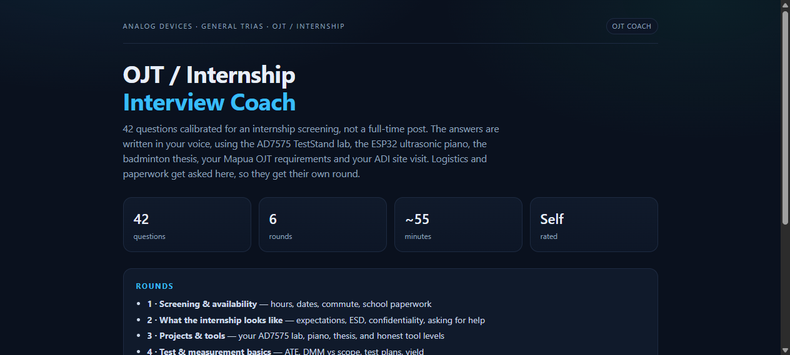
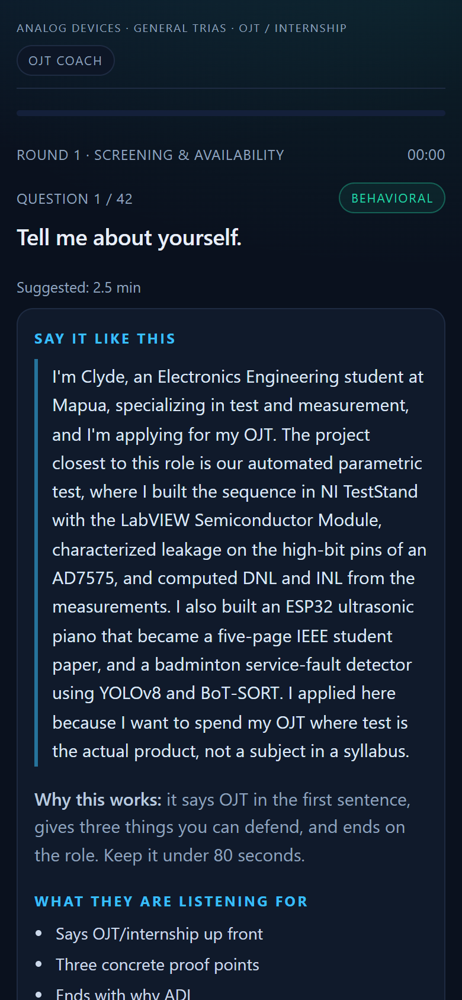

# ADI GenTri OJT Interview Coach

A single-file practice app for an **OJT / internship interview at Analog Devices, General Trias (Cavite)** — built around one ECE student's actual coursework, not generic advice.

**Live:** https://dynamix14.github.io/adi-ojt-interview-coach/



## What it does

42 questions in six rounds, ordered the way an internship screening actually runs. You answer out loud, reveal a first-person example answer written in the candidate's voice, then rate yourself honestly. At the end you get a score, a per-round breakdown, and the topic tags you are weakest on.

| Round | Content |
|---|---|
| 1 · Screening & availability | Required hours, start date, commute plan, MOA / endorsement / insurance, "why ADI" |
| 2 · What the internship looks like | Realistic intern scope, repetitive bench work, the 30-minute rule for asking for help, ESD, confidentiality |
| 3 · Projects & tools | The AD7575 TestStand parametric lab, ESP32 ultrasonic piano, badminton thesis, calibrated tool honesty |
| 4 · Test & measurement basics | ATE, wafer probe vs final test, DMM vs scope, test plans, characterization, yield, ESD |
| 5 · Circuit fundamentals | The written exam: op-amps, RC, diodes, KVL/KCL, Thevenin, BJT, MOSFET |
| 6 · Solve the schematic | Six drawn circuits with worked solutions, solved on paper |



## Features

- **Example answers, not rubrics** — 75–120 second scripts using real projects, each with a short "why this works" note and the checklist the interviewer is listening for.
- **Six inline SVG schematics** — series-parallel, loaded divider, diode clamp, RC step, inverting op-amp, Thevenin. Values are labelled on the drawing; the answer is the worked solution.
- **Per-question timer** with a suggested time, and an amber state once you run over.
- **Self-rating** (missed / partial / nailed), keyboard shortcuts: `Space` reveal, `1` `2` `3` rate, arrows navigate.
- **Results screen** with overall score, per-round bars, and weak-topic tags.
- **Progress saved locally** (`localStorage`), resumable across closes. No account, no server, no analytics.
- **Print / save PDF** stylesheet for a paper version.
- **Works offline** once loaded — one HTML file, no dependencies, no network calls.

## Mobile / iOS

Tested in a 390×844 iPhone viewport with touch emulation, plus desktop.

- `viewport-fit=cover` with `env(safe-area-inset-bottom)` padding, so the bottom controls clear the home indicator.
- All controls are at least 44 px tall, with `touch-action: manipulation` to avoid double-tap zoom lag.
- `-webkit-text-size-adjust: 100%` stops iOS from inflating text on rotate.
- `100dvh` with a `100vh` fallback for the dynamic Safari toolbar.
- 430 px breakpoint compresses the header, the stat grid, and the rating row; the 1/2/3 chips hide so the three buttons stay on one line.
- Schematics are `viewBox` SVGs at `width: 100%`, so they scale to the phone without horizontal scroll.
- `localStorage` writes are wrapped in `try/catch`, so Private Browsing (where storage throws) still works for the session.

## Run it locally

No build step:

```bash
git clone https://github.com/Dynamix14/adi-ojt-interview-coach.git
cd adi-ojt-interview-coach
python -m http.server 8000
# open http://localhost:8000
```

Or just double-click `index.html` — everything runs from the file itself.

## Editing the question bank

All content is the `Q` array near the top of the `<script>` block. Each entry:

```js
{ r: 1,                       // round id 1-6
  cat: "Availability",        // tag shown in the results screen
  t: 120,                     // suggested seconds
  q: "How many hours do you need?",   // the question
  svg: `<svg ...>`,           // optional, round 6 only
  say: `...`,                 // the spoken answer
  why: "<b>Why this works:</b> ...",
  rubric: ["...", "..."] }    // what the interviewer listens for
```

Add, remove, or rewrite entries freely; rounds, progress, scoring, and the results bars are all computed from the array. Round names live in `ROUNDS` just above it.

Square brackets in the answers (`[X hours]`, `[your commute plan]`) mark facts to fill in before using an answer for real.

## Deploy your own copy

1. Fork or create a repo and push `index.html`.
2. **Settings → Pages → Source: Deploy from a branch → `main` / `/ (root)`**.
3. The site is live at `https://<user>.github.io/<repo>/` in about a minute.

No Actions workflow is needed; Pages serves the branch directly.

## Sources and honesty notes

- The question mix comes from reported ADI interview experiences (Glassdoor role pages, Indeed Philippines company FAQ answers from General Trias employees, Reddit r/ECE threads by PH applicants) and from ADI's own General Trias postings for test-development roles. Reported questions are individual anecdotes, not a leaked question bank.
- Example answers are personal to one candidate's CV; the technical content is standard electronics and is checked for correctness, but the framing will not fit anyone else. Rewrite the "say" fields for your own projects.
- Names of people and internal teams are not included beyond what is public in job postings.

**Personal data:** the answers describe one person's school, projects, and job search. If you publish a fork, replace those details first. Consider a private repo if you would rather not disclose that you are interviewing.

## License

MIT — see [LICENSE](LICENSE).
